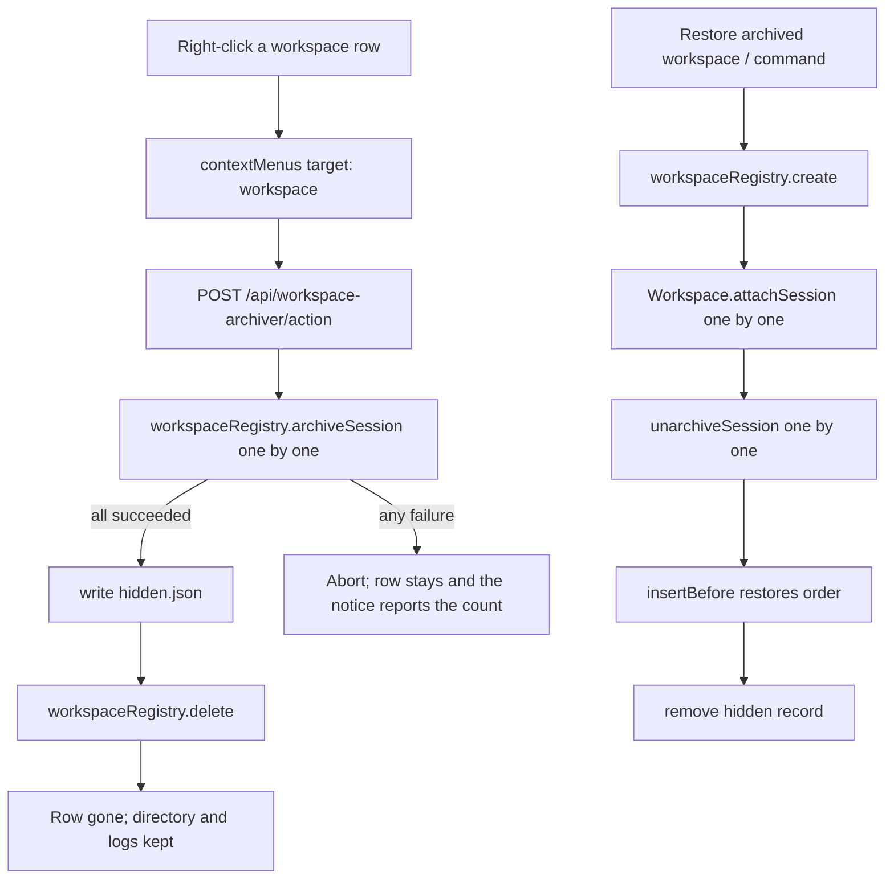

<div align="center">

<h1>dsh-workspace-archiver</h1>

<p><strong>DSH sidebar: archive and hide a workspace, then restore it together with its sessions.</strong></p>

<p><a href="README.en.md">English</a> · <a href="README.md">简体中文</a></p>

<p>
  <a href="https://github.com/PandaBoby/dsh-workspace-archiver/actions/workflows/ci.yml"></a>
  <a href="https://www.npmjs.com/package/dsh-workspace-archiver"></a>
  <a href="https://github.com/PandaBoby/dsh-workspace-archiver/releases"></a>
  <a href="LICENSE"></a>
  <a href="package.json"></a>
</p>

<p>
  <a href="#quick-start">Quick start</a> ·
  <a href="#how-it-works">How it works</a> ·
  <a href="#restore">Restore</a> ·
  <a href="#known-limitations">Known limitations</a> ·
  <a href="#troubleshooting">Troubleshooting</a> ·
  <a href="#development-and-testing">Development and testing</a>
</p>

<p><code>dsh plugin --profile &lt;profile&gt; add dsh-workspace-archiver</code></p>

</div>

---

> [!IMPORTANT]
> This repository is the only official source: <https://github.com/PandaBoby/dsh-workspace-archiver>.
> Archiving a single session is already a DSH feature. This bundle adds a **reversible
> workspace-level archive**: the Host archives every session, keeps the workspace path,
> title, order, and session ids in a hidden record, then removes the registration; restore
> recreates the workspace, reattaches the sessions with `Workspace.attachSession`, and
> unarchives the sessions this run archived.
> Restore needs the original directory and a resolvable session cwd. Deleting the hidden
> record file removes the plugin's ability to restore the registration.

<p align="center">
  
</p>
<p align="center"><sub>Illustration: “Archive and hide this workspace” in a workspace row's context menu (highlighted row). This is not a live screenshot.</sub></p>

`dsh-workspace-archiver` adds a workspace-row action to the DSH sidebar. In a **workspace
row**'s context menu (or the hover `…` menu), it archives every session of that workspace and
removes the registration so the whole row disappears. Later, **Restore archived workspace** in
any workspace menu — or the `/workspace-archiver` command when every row is hidden — recreates
the row and puts the stored sessions back.

DSH already archives individual sessions and ships a **Delete workspace** action. What this
bundle adds is **persisted membership**: after deleting the registration it can recreate the
workspace, reattach the old sessions in order, and unarchive them instead of leaving them
under Ungrouped.

> The Chinese README is the canonical version. This English translation is kept in sync.
>
> Status: the API surface and packaging were checked against DSH `0.2.2-rc.5`; the syntax gate
> and **32/32** automated tests pass. **The bundle was not installed into a live profile**, so
> the menu, restore flow, and notices are still unverified in the UI. See
> [docs/verification.md](docs/verification.md).

<details>
<summary><strong>Contents</strong></summary>

- [Features](#features)
- [Requirements](#requirements)
- [Quick start](#quick-start)
- [How it works](#how-it-works)
- [Restore](#restore)
- [Hidden record](#hidden-record)
- [Relationship to official APIs](#relationship-to-official-apis)
- [Known limitations](#known-limitations)
- [Troubleshooting](#troubleshooting)
- [Development and testing](#development-and-testing)
- [Documentation](#documentation)
- [Security](#security)
- [Contributing](#contributing)
- [Disclaimer](#disclaimer)
- [License](#license)

</details>

## Features

- **Workspace-level entry.** Appears only in a workspace row's context menu or `…` menu, at
  order 200 — between the shipped **Rename** (100) and **Delete** (300).
- **Archive first, remove second.** Reads the workspace's `sessionIds`, skips already archived
  sessions, archives the rest one by one, then has the Host persist a hidden record and delete
  the registration.
- **Abort on failure.** If any session cannot be archived (running work, missing permission),
  the workspace is **not** removed and no hidden record is written. The notice reports how many
  sessions blocked the action and the console has the per-session reason.
- **Restorable.** Every workspace menu lists archived workspaces. Restore recreates the
  workspace, reattaches the stored sessions in order, unarchives the sessions this run archived, and best-effort restores
  the workspace order.
- **All-hidden fallback.** If every workspace row is hidden, `/workspace-archiver` lists the
  hidden records and `/workspace-archiver restore <id|index>` restores one.
- **Directory and logs retained.** Only the workspace registration is removed; the directory,
  session logs, and archive set remain.
- **Running work is not stopped silently.** `stopActivity` is never passed; stopping a session
  is an explicit confirmation in DSH's per-session archive flow.
- **Duplicate-click guard.** A second click on the same workspace or hidden record is ignored
  while the first operation is pending.
- **English/Chinese, zero build.** Copy goes through `ctx.locale`; `index.js`, `client.js`, and
  `src/*.js` are the source and the shipped artifacts, with no dependencies or transpiler.

## Requirements

| Component | Requirement |
|---|---|
| DSH | `>= 0.2.2-rc.1`; API surface checked against `0.2.2-rc.5` |
| Node.js | `>= 20` for the test suite only; the plugin runs in the DSH Host and Web/Desktop page |
| Host services | `connection`, `workspaceRegistry`, `commands` (shipped by the Web profile) |
| Writable path | Hidden records at `$DSH_HOME/workspace-archiver/hidden.json` (default `~/.dsh/...`) |
| Verification | 32/32 tests pass; not yet installed in a live profile — see [docs/verification.md](docs/verification.md) |

## Quick start

### Install

Desktop: **Settings → Plugins → Add plugin → install a local plugin directory**, select this
repository, then enable **Workspace archiver**.

From a local checkout:

```sh
dsh plugin --profile <profile> add /absolute/path/to/dsh-workspace-archiver
```

From npm:

```sh
dsh plugin --profile <profile> add dsh-workspace-archiver
```

Reload the page once after installing or enabling; the browser bundle is served from the
package's `./client` export.

### Use

1. Find the target **workspace row** in the sidebar (the folder row, not a session row below
   it).
2. Right-click it, or hover and click `…`.
3. Choose **Archive and hide this workspace (N sessions)**. With no unarchived sessions left,
   the item reads **Hide this workspace**.
4. On success the row disappears and the notice reports how many sessions were archived; the
   directory and session logs are kept.

> A session row's own `…` menu is a different official menu (rename, fork, archive one session,
> and so on). It is not this plugin's entry.
>
> If you only want to remove the registration without archiving sessions, the shipped **Delete
> workspace** action already does that.

### Load from a source checkout

From a DSH source checkout:

```sh
pnpm dsh web --patch /absolute/path/to/dsh-workspace-archiver/dev.patch.yml
```

Replace the `/absolute/path/...` placeholder in `dev.patch.yml` with this checkout's real path.
The overlay mounts `index.js` by absolute path; client-modules walks up to `package.json`,
reads `dsh.client`, and serves `client.js`. This path requires a DSH source checkout. For a
pure-runtime Desktop install, use the install instructions above. There is no build step: save
a file and reload the page.

## How it works



1. DSH's workspace row dispatches a `{ kind: 'workspace' }` context-menu target itself; the
   plugin registers a contribution for that target and never takes over the DOM.
2. When the menu opens, the plugin reads the unarchived count from `ctx.workspaces.list` and
   fetches hidden records from `GET /api/workspace-archiver/state`.
3. Archive posts `{action:'archive', workspaceId}`. The Host archives each candidate with
   `workspaceRegistry.archiveSession`; only after every archive succeeds does it persist
   `{path,title,anchor,sessionIds}` and call `delete`. A failure leaves the workspace untouched.
4. Restore posts `{action:'restore', hiddenId}`. The Host calls `workspaceRegistry.create`
   (or reuses a workspace already registered at that path), attaches sessions in reverse order
   (the entity prepends), unarchives them, restores the order around the saved anchor, and
   removes the hidden record.
5. If every workspace is hidden, the `/workspace-archiver` command provides the same list and
   restore path.

## Restore

Choose **Restore archived workspace** in a workspace row's `…` menu, then pick the target. Or:

```text
/workspace-archiver                         list archived workspaces
/workspace-archiver restore <id|index>      restore one
```

What restore does:

- recreates the row from the saved path/title;
- reattaches the old sessions in their saved order and unarchives only the ones this run archived; a session archived separately before the workspace archive stays archived;
- if a session's stored cwd no longer exists or does not resolve, `attachSession` rejects it;
  the result reports how many were not reattached, and those sessions stay archived with their
  logs intact;
- a session that was already archived separately before the workspace archive is reattached but
  stays archived; only the sessions this run archived are unarchived;
- if a workspace already exists at the same path, restore reuses it instead of creating a
  second one.

## Hidden record

The Host stores hidden records at:

```text
$DSH_HOME/workspace-archiver/hidden.json
```

The default is `~/.dsh/workspace-archiver/hidden.json`; the file is created with mode `0600`
and its directory with `0700`. It contains workspace paths, titles, order anchors, session ids,
and timestamps — **no credentials**.

- This file is the only source of workspace membership for restore. Deleting it leaves the
  directory and session logs untouched, but the plugin can no longer restore the registration.
- Writes are serialized and only happen before the registration is deleted; a write failure
  aborts the archive.
- Keep the file when migrating a profile if you want restore to survive the move.

## Relationship to official APIs

| Official capability | How this bundle uses it |
|---|---|
| `ctx.contextMenus.register({ target: 'workspace' })` | The workspace-row menu contribution; the shipped row component already dispatches this target |
| `ctx.connection.fetch.register` | Authenticated browser routes; Connection owns Host/Origin checks and browser authentication |
| `workspaceRegistry.archiveSession` / `unarchiveSession` | Session archive/restore |
| `workspaceRegistry.create` / `delete` / `insertBefore` | Recreate/remove the registration and restore order |
| `Workspace.attachSession` | Host-side reattachment; the Client has no Remote for it |
| `ctx.workspaces.list` | Workspace rows, membership, and the archive set (read-only) |
| `ctx.locale` / `ctx.commands` | Bilingual copy and the all-hidden command fallback |
| Official bundle contract | `dsh.bundle.patch`, `dsh.client`, `./client` export, `cordis.patch.yml`, `locale/*.json`, detail image, 36×36 icon |

Official capabilities that do **not** exist in DSH `0.2.2-rc.5`:

- **No workspace-level archive/hide API.** The only public operation that removes a row is
  `delete`; restoreability comes from the Host-held hidden record, not from registry state.
- **No Client `attachSession`.** Restore must run on the Host, which is why this bundle has a
  Host half and authenticated routes.
- **No `ctx.ui.registerMenuItem`, no `sidebar.workspaces.menu.item`.** Workspace menus are the
  `workspace` target of `ctx.contextMenus`; `sidebar.workspaces.session.menu.item` is the
  legacy React menu of a session row.
- **No per-workspace confirmation dialog.** The archive item is danger-styled with an explicit
  label; there is no custom modal.
- **External plugins cannot import `dsh-client-ui-primitives`**, so the menu item has no icon.

## Known limitations

- **Restore needs the original directory.** `workspaceRegistry.create` resolves the real path
  and requires a valid directory; a missing/moved directory fails the restore and keeps the
  record.
- **Some sessions may not reattach.** `attachSession` re-resolves the stored cwd; a missing or
  invalid cwd skips that session and reports it. Its log stays intact.
- **A same-path workspace merges.** If you re-add the directory before restoring, the existing
  workspace is reused and the stored sessions are prepended; it is not renamed or recreated.
- **A running session blocks the whole archive.** If any candidate fails, the workspace stays
  as is. Stop or wait for those sessions, or use the shipped per-session “stop and archive”
  confirmation.
- **A failed delete leaves “sessions archived, row still present”.** Usually a permission or
  Host failure; retry (archived sessions are skipped) or unarchive manually.
- **The hidden record is local plugin state.** It is not part of the registry and does not
  migrate with it; losing the file loses the plugin's restore path (the data remains).
- **The command needs a session/composer.** When every row is hidden, use
  `/workspace-archiver`; a UI without a composer has no fallback.
- **The menu item has no icon.** Official icon components are not importable by external
  plugins; adding one would require a one-off React component.

## Troubleshooting

| Symptom | What to do |
|---|---|
| No menu item | Confirm the plugin is enabled and reload; right-click a **workspace row**; a missing Host half makes archive requests fail with a notice |
| The row did not disappear | The notice distinguishes an archive failure from a delete failure; archive failures are usually running sessions, with per-session reasons in the console |
| The restore submenu is empty | There are no hidden records, or the Host state route failed; use `/workspace-archiver` to check |
| Restore failed | Usually the original directory was removed/moved or a cwd no longer resolves; the record is kept, so fix the directory and retry |
| The restored workspace is empty | Sessions failed to reattach; the notice/command reports the count; check each session's cwd |
| Every workspace is gone | Type `/workspace-archiver` in the composer and restore by index/id |
| Installing changed nothing | Check that **Workspace archiver** is enabled in Plugins; toggle it or reload; verify the package's `client.js` is linked |

## Development and testing

Zero build, zero dependencies. Node.js >= 20 is needed only for the tests:

```sh
npm run check     # Host/Client syntax, exports, JSON, patch row
npm test          # syntax gate + packaging, Host archive/restore, Client behavior (32 tests)
```

CI runs `npm test` on Node 20, 22, and 24. Before publishing:

```sh
npm pack --dry-run     # 25 files; src/ ships with the bundle
```

The live-profile checklist is in [docs/verification.md](docs/verification.md).

## Documentation

- [README.md](README.md) — canonical Simplified Chinese README
- [CHANGELOG.md](CHANGELOG.md) — release history
- [CONTRIBUTING.md](CONTRIBUTING.md) — contribution and release process
- [SECURITY.md](SECURITY.md) — boundaries and vulnerability reporting
- [docs/verification.md](docs/verification.md) — verified, unverified, and manual checks
- [docs/DETAIL.md](docs/DETAIL.md) — single-image plugin detail document

## Security

The plugin makes no outbound network requests and reads no credentials. The Host routes read
workspace/session ids and hidden records and call the Workspace Registry; the hidden file
contains paths, titles, and session ids (no secrets) with mode `0600`. The routes rely on DSH
Connection Host/Origin checks and browser authentication and maintain no separate token; they
are intended for a trusted profile/browser. Removing a registration and restoring it keep the
directory and session logs; losing the hidden file loses the plugin's restore ability, not the
data. Report vulnerabilities through the private channel in [SECURITY.md](SECURITY.md).

## Contributing

Issues and pull requests are welcome; read [CONTRIBUTING.md](CONTRIBUTING.md) first. Behavior
changes need tests and a `CHANGELOG.md` entry; the Host archive/restore path must keep the
“failure does not lose membership” guarantee. Keep the Chinese and English READMEs in the same
structure.

## Disclaimer

Provided as-is, without warranty of any kind. Archiving removes the workspace registration;
restore depends on the directory, session cwd, and hidden record file still being available.
Verify in a test profile before using it on a production profile. Losses caused by unintended
archives, directory changes, a lost hidden record, or third-party plugins are the user's
responsibility.

## License

[MIT](LICENSE) © 2026 dsh-workspace-archiver contributors
