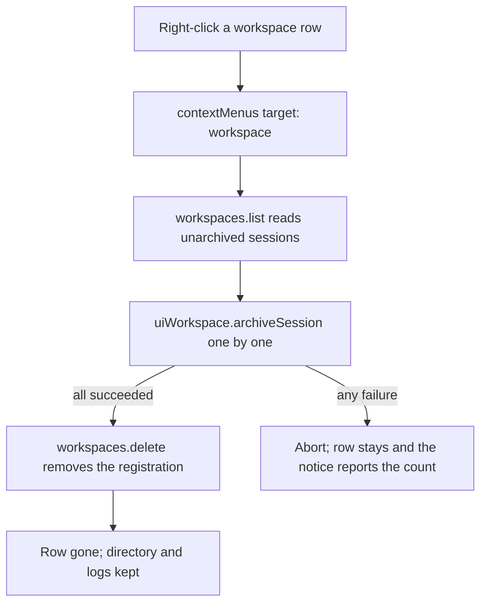

<div align="center">

<h1>dsh-workspace-archiver</h1>

<p><strong>DSH sidebar: archive and hide a workspace row — archive every session, then remove the workspace registration.</strong></p>

<p><a href="README.en.md">English</a> · <a href="README.md">简体中文</a></p>

<p>
  <a href="https://github.com/PandaBoby/dsh-workspace-archiver/actions/workflows/ci.yml"></a>
  <a href="https://www.npmjs.com/package/dsh-workspace-archiver"></a>
  <a href="https://github.com/PandaBoby/dsh-workspace-archiver/releases"></a>
  <a href="LICENSE"></a>
  <a href="package.json"></a>
</p>

<p>
  <a href="#quick-start">Quick start</a> ·
  <a href="#how-it-works">How it works</a> ·
  <a href="#known-limitations">Known limitations</a> ·
  <a href="#troubleshooting">Troubleshooting</a> ·
  <a href="#development-and-testing">Development and testing</a>
</p>

<p><code>dsh plugin --profile &lt;profile&gt; add dsh-workspace-archiver</code></p>

</div>

---

> [!IMPORTANT]
> This repository is the only official source: <https://github.com/PandaBoby/dsh-workspace-archiver>.
> Archiving a single session is already a DSH feature. This bundle adds a **workspace-level
> action**: archive every session of the workspace, then remove the workspace registration so
> the row leaves the sidebar.
> This is a **one-way archive**: the directory and every session log are kept, but workspace
> membership cannot be restored through any public API, and re-adding the directory creates a
> new, empty workspace. See [Known limitations](#known-limitations).

<p align="center">
  
</p>
<p align="center"><sub>Illustration: “Archive and hide this workspace” in a workspace row's context menu (highlighted row). This is not a live screenshot.</sub></p>

`dsh-workspace-archiver` adds a workspace-row action to the DSH sidebar. In a **workspace
row**'s context menu (or the hover `…` menu), it first archives every unarchived session of
that workspace, then removes the workspace registration. When both steps succeed, the whole row
disappears and those sessions no longer show up in the default view.

DSH already archives individual sessions, and the shipped **Delete workspace** action removes a
registration. What this bundle adds is **one click that does both**, so removing the row does
not dump unarchived sessions into Ungrouped.

> The Chinese README is the canonical version. This English translation is kept in sync.
>
> Status: the API surface and packaging were checked against DSH `0.2.2-rc.5`; the syntax gate
> and automated tests pass. **The bundle was not installed into a live profile**, so the menu,
> notice, and row removal are still unverified in the UI. See
> [docs/verification.md](docs/verification.md).

<details>
<summary><strong>Contents</strong></summary>

- [Features](#features)
- [Requirements](#requirements)
- [Quick start](#quick-start)
- [How it works](#how-it-works)
- [Relationship to official APIs](#relationship-to-official-apis)
- [Known limitations](#known-limitations)
- [Troubleshooting](#troubleshooting)
- [Development and testing](#development-and-testing)
- [Documentation](#documentation)
- [Security](#security)
- [Contributing](#contributing)
- [Disclaimer](#disclaimer)
- [License](#license)

</details>

## Features

- **Workspace-level entry.** Appears only in a workspace row's context menu or `…` menu, at
  order 200 — between the shipped **Rename** (100) and **Delete** (300).
- **Archive first, remove second.** Reads the workspace's `sessionIds`, skips already archived
  sessions, archives the rest one by one, and only then calls `ctx.workspaces.delete` to remove
  the registration.
- **Abort on failure.** If any session cannot be archived (running work, missing permission),
  the workspace is **not** removed. The notice reports how many sessions blocked the action and
  the console has the per-session reason, so the row can never disappear while unarchived
  sessions are stranded.
- **Directory and logs retained.** Only the workspace registration is removed, matching the
  shipped `delete` semantics: the directory, session logs, and archive set remain.
- **Running work is not stopped silently.** `stopActivity` is never passed; stopping a session
  is an explicit confirmation in DSH's per-session archive flow.
- **Duplicate-click guard.** A second click on the same workspace is ignored while the first run
  is still awaiting the Host.
- **English and Chinese.** Menu and notice copy is registered through `ctx.locale`.
- **Zero build.** `index.js` / `client.js` are the source and the shipped artifacts at the same
  time; no dependencies, transpiler, or lockfile.

## Requirements

| Component | Requirement |
|---|---|
| DSH | `>= 0.2.2-rc.1`; API surface checked against `0.2.2-rc.5` |
| Node.js | `>= 20` for the test suite only; the plugin runs in the DSH Web/Desktop page |
| Extra services | None; uses the profile's Workspace Controller, Context Menu, and Locale |
| Verification | Automated tests pass; not yet installed in a live profile — see [docs/verification.md](docs/verification.md) |

## Quick start

### Install

Desktop: **Settings → Plugins → Add plugin → install a local plugin directory**, select this
repository, then enable **Workspace archiver**.

From a local checkout:

```sh
dsh plugin --profile <profile> add /absolute/path/to/dsh-workspace-archiver
```

From npm:

```sh
dsh plugin --profile <profile> add dsh-workspace-archiver
```

Reload the page once after installing or enabling; the browser bundle is served from the
package's `./client` export.

### Use

1. Find the target **workspace row** in the sidebar (the folder row, not a session row below
   it).
2. Right-click it, or hover and click `…`.
3. Choose **Archive and hide this workspace (N sessions)**. With no unarchived sessions left,
   the item reads **Hide this workspace**.
4. On success the row disappears and the notice reports how many sessions were archived; the
   directory and session logs are kept.

> A session row's own `…` menu is a different official menu (rename, fork, archive one session,
> and so on). It is not this plugin's entry.
>
> If you only want to remove the registration without archiving sessions, the shipped **Delete
> workspace** action already does that.

### Load from a source checkout

From a DSH source checkout:

```sh
pnpm dsh web --patch /absolute/path/to/dsh-workspace-archiver/dev.patch.yml
```

Replace the `/absolute/path/...` placeholder in `dev.patch.yml` with this checkout's real path.
The overlay mounts `index.js` by absolute path; client-modules walks up to `package.json`,
reads `dsh.client`, and serves `client.js`. This path requires a DSH source checkout. For a
pure-runtime Desktop install, use the install instructions above. There is no build step: save
a file and reload the page.

## How it works



1. DSH's workspace row dispatches a `{ kind: 'workspace' }` context-menu target itself; the
   plugin registers a contribution for that target and never takes over the DOM.
2. When the menu opens, the plugin reads the workspace's `sessionIds` and the registry-global
   archive set from `ctx.workspaces.list`.
3. On click, each remaining session is awaited through `ctx.uiWorkspace.archiveSession(id)`.
   That is the official UI service: it delegates to the Workspace Controller, reaches the Host
   via the `workspace/archiveSession` Remote, and finally calls
   `workspaceRegistry.archiveSession`. It also clears the conversation panel when the archived
   session is the one on screen.
4. Only when every archive succeeds does the plugin call `ctx.workspaces.delete(workspaceId)` —
   the Client entry of the shipped **Delete workspace** action. It removes the registration and
   keeps the directory and session logs; the Client model removes the row.
5. Any archive failure aborts before the delete. The notice reports the blocked count and the
   console logs each session's reason.

## Relationship to official APIs

| Official capability | How this bundle uses it |
|---|---|
| `ctx.contextMenus.register({ target: 'workspace' })` | The workspace-row menu contribution; the shipped row component already dispatches this target |
| `ctx.uiWorkspace.archiveSession` | The same UI service the shipped per-session archive button uses, including main-view clearing |
| `ctx.workspaces.list` | Workspace rows, membership, and the registry-global archive set (read-only) |
| `ctx.workspaces.delete` | The Client entry of **Delete workspace**; removes the registration and keeps the directory and logs |
| `ctx.locale.register` / `bind` | Bilingual copy and live language switching |
| Official bundle contract | `dsh.bundle.patch`, `dsh.client`, `./client` export, `cordis.patch.yml`, `locale/*.json`, detail image, 36×36 icon |

Official capabilities that do **not** exist in DSH `0.2.2-rc.5`, so nothing was invented to
stand in for them:

- **No workspace-level archive/hide API.** The only public operation that makes the row
  disappear is `workspaces.delete` (the shipped **Delete workspace** action); it removes the
  registration instead of marking it hidden.
- **No public Client API to restore membership.** The Host `Workspace.attachSession` is not
  exposed through the Remote, so the plugin cannot reattach old sessions to a re-created
  workspace; there is no undo.
- **No `ctx.ui.registerMenuItem`, no `sidebar.workspaces.menu.item`.** Workspace menus are the
  `workspace` target of `ctx.contextMenus`; `sidebar.workspaces.session.menu.item` is the
  legacy React menu of a session row.
- **No per-workspace confirmation dialog.** DSH confirms per session/operation; this bundle uses
  a `danger` menu item with an explicit label instead of a custom modal.
- **External plugins cannot import `dsh-client-ui-primitives`** (DSH asks plugins to write their
  own controls), so the menu item has no icon.

## Known limitations

- **One-way archive, no undo.** A removed registration cannot be restored through a public API.
  Re-adding the directory creates a new, empty workspace; old sessions are not reattached.
- **Old sessions reappear under Ungrouped if unarchived.** The archive set is global. After
  re-adding the directory, unarchiving an old session puts it under Ungrouped, not the new
  workspace.
- **A running session blocks the whole action.** If any candidate fails to archive, the
  workspace stays as it is. Stop or wait for those sessions first, or use the shipped
  per-session archive confirmation that offers “stop and archive”.
- **A failed delete leaves “sessions archived, row still present”.** Usually a permission or
  Host failure; retry (already archived sessions are skipped) or unarchive manually.
- **The action looks destructive because it is.** It is the official `delete` plus session
  archiving; verify in a scratch profile or a test workspace first.
- **The menu item has no icon.** Official icon components are not importable by external
  plugins; adding one would require a one-off React component, and the browser half stays
  React-free on purpose.

## Troubleshooting

| Symptom | What to do |
|---|---|
| No menu item | Confirm the plugin is enabled and reload the page; right-click a **workspace row**; it does not appear for a workspace that is no longer listed |
| The row did not disappear | The notice distinguishes an archive failure from a delete failure; archive failures are usually running sessions, with per-session reasons in the console |
| The row is gone but old sessions show under Ungrouped | After re-adding the directory, unarchived old sessions land in Ungrouped; membership is not restored — see [Known limitations](#known-limitations) |
| Re-adding the directory gives an empty workspace | Expected: `create` starts with an empty member list and does not scan historical sessions |
| Trying to restore the workspace | There is no undo; re-adding the directory creates an empty workspace and old sessions stay in the archive set / Ungrouped |
| Installing changed nothing | Check that **Workspace archiver** is enabled in Plugins; toggle it or reload; verify the package's `client.js` is linked |

## Development and testing

Zero build, zero dependencies. Node.js >= 20 is needed only for the tests:

```sh
npm run check     # client.js syntax, index.js exports, JSON, patch row
npm test          # syntax gate + packaging and behavior tests
```

CI runs `npm test` on Node 20, 22, and 24. Before publishing:

```sh
npm pack --dry-run
```

The live-profile checklist is in [docs/verification.md](docs/verification.md).

## Documentation

- [README.md](README.md) — canonical Simplified Chinese README
- [CHANGELOG.md](CHANGELOG.md) — release history
- [CONTRIBUTING.md](CONTRIBUTING.md) — contribution and release process
- [SECURITY.md](SECURITY.md) — boundaries and vulnerability reporting
- [docs/verification.md](docs/verification.md) — verified, unverified, and manual checks
- [docs/DETAIL.md](docs/DETAIL.md) — single-image plugin detail document

## Security

The plugin is offline: it reads no files, credentials, or environment variables, and sends no
data anywhere. It reads workspace/session ids and the archive set, archives sessions through
`ctx.uiWorkspace.archiveSession`, and removes the workspace registration through
`ctx.workspaces.delete`. The Host enforces the current peer's permissions; the plugin does not
bypass them. Removing the registration keeps the directory and session logs but **cannot be
undone through a public API**; treat a directory/data backup as part of archiving. Report
vulnerabilities through the private channel in [SECURITY.md](SECURITY.md).

## Contributing

Issues and pull requests are welcome; read [CONTRIBUTING.md](CONTRIBUTING.md) first. Behavior
changes need tests and a `CHANGELOG.md` entry. Keep the Chinese and English READMEs in the same
structure.

## Disclaimer

Provided as-is, without warranty of any kind. Archiving and hiding is a non-undoable workspace
registration removal; sessions can be unarchived individually, but membership is not restored.
Verify in a test profile before using it on a production profile. Losses caused by unintended
archives, permission configuration, or third-party plugins are the user's responsibility.

## License

[MIT](LICENSE) © 2026 dsh-workspace-archiver contributors
