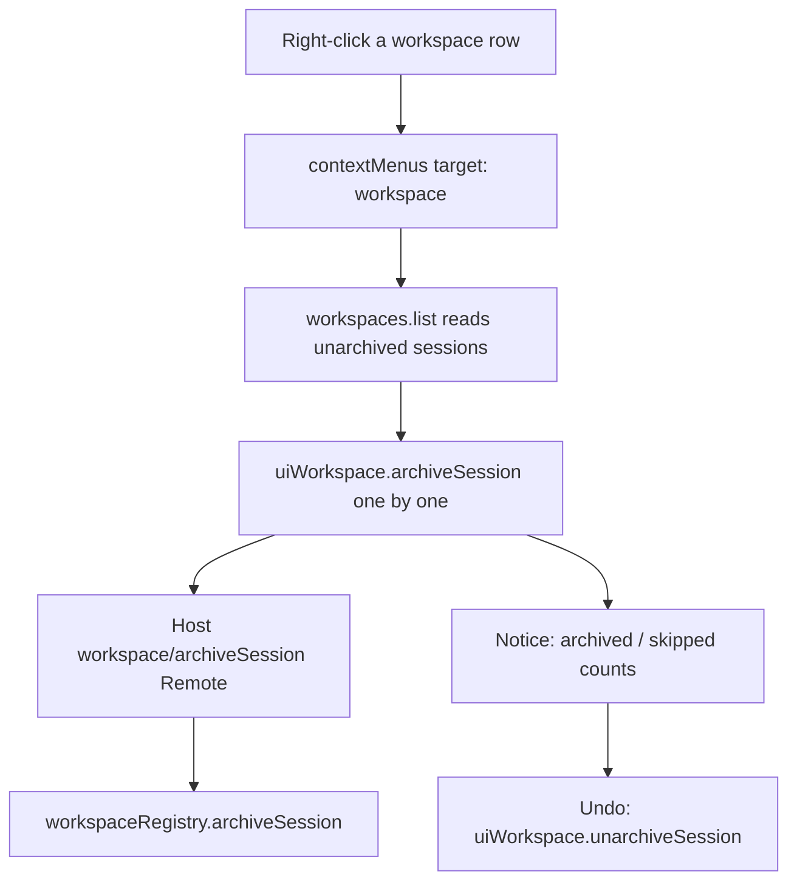

<div align="center">

<h1>dsh-workspace-archiver</h1>

<p><strong>DSH sidebar: archive every session of one workspace in a single click, with an undo notice.</strong></p>

<p><a href="README.en.md">English</a> · <a href="README.md">简体中文</a></p>

<p>
  <a href="https://github.com/PandaBoby/dsh-workspace-archiver/actions/workflows/ci.yml"></a>
  <a href="https://www.npmjs.com/package/dsh-workspace-archiver"></a>
  <a href="https://github.com/PandaBoby/dsh-workspace-archiver/releases"></a>
  <a href="LICENSE"></a>
  <a href="package.json"></a>
</p>

<p>
  <a href="#quick-start">Quick start</a> ·
  <a href="#how-it-works">How it works</a> ·
  <a href="#known-limitations">Known limitations</a> ·
  <a href="#troubleshooting">Troubleshooting</a> ·
  <a href="#development-and-testing">Development and testing</a>
</p>

<p><code>dsh plugin --profile &lt;profile&gt; add dsh-workspace-archiver</code></p>

</div>

---

> [!IMPORTANT]
> This repository is the only official source: <https://github.com/PandaBoby/dsh-workspace-archiver>.
> The plugin does not access the network, read credentials, or delete session logs. Archiving
> moves sessions out of the default sidebar view, and undo uses the official
> `unarchiveSession` API.
> **It does not hide the workspace folder row**: DSH has no workspace-level hide API. See
> [Known limitations](#known-limitations).

<p align="center">
  
</p>
<p align="center"><sub>Illustration: “Archive sessions in this workspace” in a workspace row's context menu (highlighted row). This is not a live screenshot.</sub></p>

`dsh-workspace-archiver` adds one workspace-level action to the
[DeepSeek Harness](https://github.com/deepseek-ai) sidebar: in a **workspace row**'s context
menu (or the hover `…` menu), archive every unarchived session of that workspace and report the
result in a notice with **Undo**.

It uses only public DSH extension points: `ctx.contextMenus` for the menu item,
`ctx.workspaces.list` for state, `ctx.uiWorkspace` for archive/restore, and `ctx.locale` for
copy. No custom route, no private permission layer, no DOM hooks.

> The Chinese README is the canonical version. This English translation is kept in sync.
>
> Status: the API surface and packaging were checked against DSH `0.2.2-rc.5`; the syntax gate
> and automated tests pass. **The bundle was not installed into a live profile**, so the menu,
> notice, undo, and detail page are still unverified in the UI. See
> [docs/verification.md](docs/verification.md).

<details>
<summary><strong>Contents</strong></summary>

- [Features](#features)
- [Requirements](#requirements)
- [Quick start](#quick-start)
- [How it works](#how-it-works)
- [Relationship to official APIs](#relationship-to-official-apis)
- [Known limitations](#known-limitations)
- [Troubleshooting](#troubleshooting)
- [Development and testing](#development-and-testing)
- [Documentation](#documentation)
- [Security](#security)
- [Contributing](#contributing)
- [Disclaimer](#disclaimer)
- [License](#license)

</details>

## Features

- **Workspace-level entry.** Appears only in a workspace row's context menu or `…` menu, at
  order 200 — between the shipped **Rename** (100) and **Delete** (300).
- **Bulk without surprises.** Reads the workspace's `sessionIds`, excludes already archived
  sessions, and archives the rest one by one. The item hides when nothing is left to archive.
- **Running work is not stopped silently.** `stopActivity` is never passed, so the Host refuses
  busy sessions; the notice counts them and the rest of the batch continues.
- **Undo.** The notice restores exactly the sessions that run archived. One failed restore does
  not abort the rest of the batch.
- **Sequential by design.** Every archive reply carries the complete archive set; `await`
  avoids depending on reply order and avoids hammering the Host.
- **Duplicate-click guard.** A second click on the same workspace is ignored while the first
  run is still awaiting the Host.
- **English and Chinese.** Menu and notice copy is registered through `ctx.locale`; an open menu
  re-resolves when the language changes.
- **Zero build.** `index.js` / `client.js` are the source and the shipped artifacts at the same
  time; no dependencies, transpiler, or lockfile.

## Requirements

| Component | Requirement |
|---|---|
| DSH | `>= 0.2.2-rc.1`; API surface checked against `0.2.2-rc.5` |
| Node.js | `>= 20` for the test suite only; the plugin runs in the DSH Web/Desktop page |
| Extra services | None; uses the profile's Workspace Controller, Context Menu, and Locale |
| Verification | Automated tests pass; not yet installed in a live profile — see [docs/verification.md](docs/verification.md) |

## Quick start

### Install

Desktop: **Settings → Plugins → Add plugin → install a local plugin directory**, select this
repository, then enable **Workspace archiver**.

From a local checkout:

```sh
dsh plugin --profile <profile> add /absolute/path/to/dsh-workspace-archiver
```

From npm (after publishing):

```sh
dsh plugin --profile <profile> add dsh-workspace-archiver
```

Reload the page once after installing or enabling; the browser bundle is served from the
package's `./client` export.

### Use

1. Find the target **workspace row** in the sidebar (the folder row, not a session row below
   it).
2. Right-click it, or hover and click `…`.
3. Choose **Archive sessions in this workspace**.
4. The notice reports how many sessions were archived; choose **Undo** to restore them.

> A session row's own `…` menu is a different official menu (rename, fork, archive one session,
> and so on). It is not this plugin's entry.

### Load from a source checkout

From a DSH source checkout:

```sh
pnpm dsh web --patch /absolute/path/to/dsh-workspace-archiver/dev.patch.yml
```

`dev.patch.yml` mounts `index.js` by absolute path; client-modules walks up to `package.json`,
reads `dsh.client`, and serves `client.js`. This path requires a DSH source checkout. For a
pure-runtime Desktop install, use the install instructions above. There is no build step: save
a file and reload the page.

## How it works



1. DSH's workspace row dispatches a `{ kind: 'workspace' }` context-menu target itself; the
   plugin registers a contribution for that target and never takes over the DOM.
2. When the menu opens, the plugin reads the workspace's `sessionIds` and the registry-global
   archive set from `ctx.workspaces.list`.
3. On click, each candidate is awaited through `ctx.uiWorkspace.archiveSession(id)`. That is
   the official UI service: it delegates to the Workspace Controller, reaches the Host via the
   `workspace/archiveSession` Remote, and finally calls `workspaceRegistry.archiveSession`. It
   also clears the conversation panel when the archived session is the one on screen.
4. Successful ids form the undo set; failures are logged and counted. The notice is shown
   through `ctx.contextMenus.notify`, and undo awaits
   `ctx.uiWorkspace.unarchiveSession(id)` for each id.

## Relationship to official APIs

| Official capability | How this bundle uses it |
|---|---|
| `ctx.contextMenus.register({ target: 'workspace' })` | The workspace-row menu contribution; the shipped row component already dispatches this target |
| `ctx.contextMenus.notify(text, ok, action)` | The result notice and its undo action |
| `ctx.uiWorkspace.archiveSession` / `unarchiveSession` | The same UI service the shipped archive button uses, including main-view clearing |
| `ctx.workspaces.list` | Workspace rows, membership, and the registry-global archive set (read-only) |
| `ctx.locale.register` / `bind` | Bilingual copy and live language switching |
| Official bundle contract | `dsh.bundle.patch`, `dsh.client`, `./client` export, `cordis.patch.yml`, `locale/*.json`, detail image, 36×36 icon |

Official capabilities that do **not** exist in DSH `0.2.2-rc.5`, so nothing was invented to
stand in for them:

- **No workspace-level archive/hide API.** The registry is session-level only, which is why the
  action loops over `sessionIds`; a fully archived workspace still renders its group row.
- **No `ctx.ui.registerMenuItem`, no `sidebar.workspaces.menu.item`.** Workspace menus are the
  `workspace` target of `ctx.contextMenus`; `sidebar.workspaces.session.menu.item` is the
  legacy React menu of a session row.
- **External plugins cannot import `dsh-client-ui-primitives`** (DSH explicitly asks plugins to
  write their own controls), so the menu item has no icon rather than an improvised one.
- **No per-workspace confirmation dialog.** DSH's confirmation flow is per session, so bulk runs
  skip busy sessions and report them instead of stopping work.
- `ctx.remoteAccess.source(...)` is documented as owner-only for the resource kind; this plugin
  does not reach into that permission plumbing. The Host enforces permissions on every archive.

## Known limitations

- **The workspace row does not disappear.** After archiving every session the group is empty,
  but DSH still renders one row per registered workspace
  (`dsh-client-ui-workspace/src/client/tree.ts`, `groupByWorkspace`, 0.2.2-rc.5). Truly hiding
  the row needs an upstream filter change, deleting the workspace registration (the shipped
  **Delete** action; sessions fall back to the ungrouped bucket), or replacing the whole
  `sidebar.workspaces` slot. This plugin does none of those.
- **Running sessions are not archived.** The plugin never passes `stopActivity: true`; stop or
  wait for those sessions first, or use the shipped per-session archive confirmation that
  offers “stop and archive”.
- **Undo covers the most recent run only.** After the notice is dismissed, restore individual
  sessions from the archived view or the session row menu.
- **A bulk archive looks destructive.** It is reversible, but the notice is transient. Verify
  in a scratch profile or a test workspace first.
- **The menu item has no icon.** Official icon components are not importable by external
  plugins; adding one would require a one-off React component, and the browser half stays
  React-free on purpose.

## Troubleshooting

| Symptom | What to do |
|---|---|
| No menu item | Confirm the plugin is enabled and reload the page; right-click a **workspace row**; the item hides when the workspace has no unarchived sessions |
| Nothing archived after the click | Usually every candidate is running, or the current peer lacks archive permission; the notice counts skips and the console has the per-session reason |
| Undo is gone | The notice was dismissed, or nothing was archived successfully; restore sessions from the archived view one by one |
| The workspace row is still there | Expected; see [Known limitations](#known-limitations) |
| Installing changed nothing | Check that **Workspace archiver** is enabled in Plugins; toggle it or reload; verify the package's `client.js` is linked |

## Development and testing

Zero build, zero dependencies. Node.js >= 20 is needed only for the tests:

```sh
npm run check     # client.js syntax, index.js exports, JSON, patch row
npm test          # syntax gate + packaging and behavior tests
```

CI runs `npm test` on Node 20, 22, and 24. Before publishing:

```sh
npm pack --dry-run
```

The live-profile checklist is in [docs/verification.md](docs/verification.md).

## Documentation

- [README.md](README.md) — canonical Simplified Chinese README
- [CHANGELOG.md](CHANGELOG.md) — release history
- [CONTRIBUTING.md](CONTRIBUTING.md) — contribution and release process
- [SECURITY.md](SECURITY.md) — boundaries and vulnerability reporting
- [docs/verification.md](docs/verification.md) — verified, unverified, and manual checks
- [docs/DETAIL.md](docs/DETAIL.md) — single-image plugin detail document

## Security

The plugin is offline: it reads no files, credentials, or environment variables, and sends no
data anywhere. It reads workspace/session ids and the archive set, and archives or restores
through `ctx.uiWorkspace`. The Host enforces the current peer's permissions; the plugin does
not bypass them. Archiving retains session logs and workspace accounting but removes sessions
from the default view; treat the notice's undo as a short-lived escape hatch, not a backup.
Report vulnerabilities through the private channel in [SECURITY.md](SECURITY.md).

## Contributing

Issues and pull requests are welcome; read [CONTRIBUTING.md](CONTRIBUTING.md) first. Behavior
changes need tests and a `CHANGELOG.md` entry. Keep the Chinese and English READMEs in the same
structure.

## Disclaimer

Provided as-is, without warranty of any kind. A bulk archive is reversible, but the notice is
transient; verify in a test profile before using it on a production profile. Losses caused by
unintended archives, permission configuration, or third-party plugins are the user's
responsibility.

## License

[MIT](LICENSE) © 2026 dsh-workspace-archiver contributors
