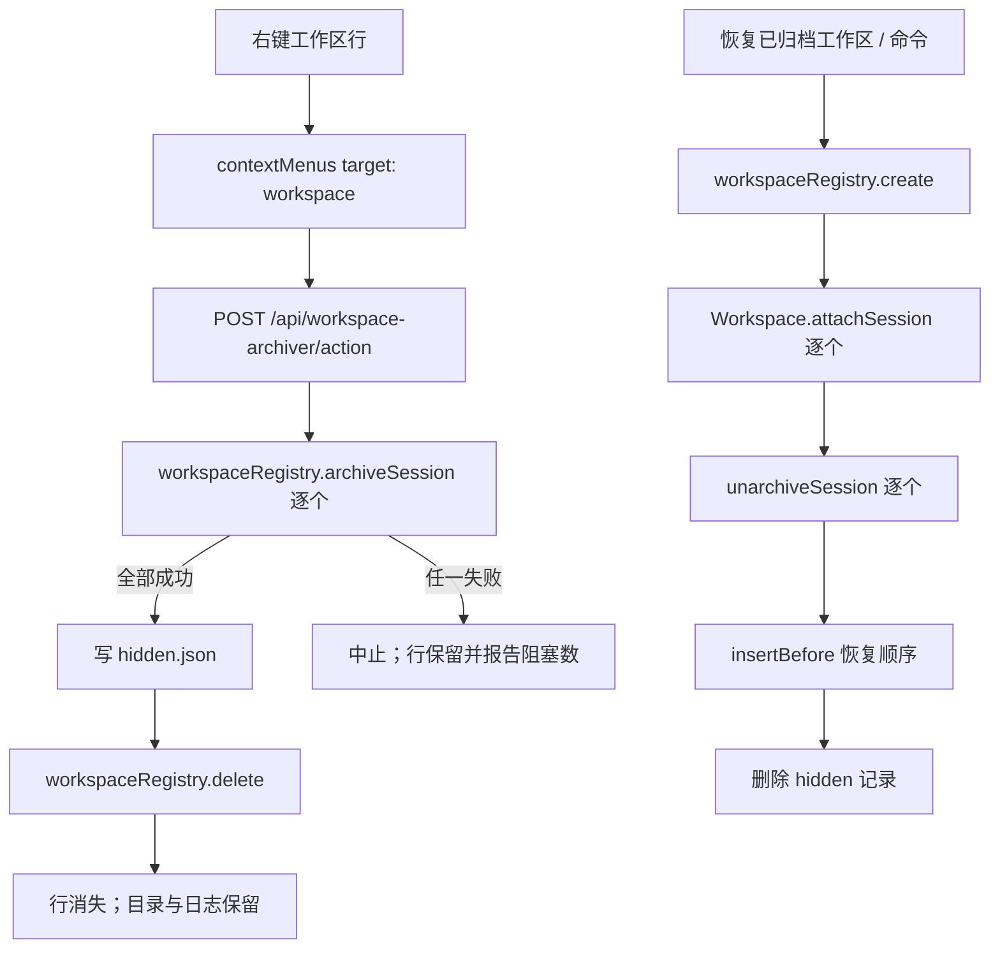

<div align="center">

<h1>dsh-workspace-archiver</h1>

<p><strong>DSH 侧边栏：归档并隐藏一个工作区，之后可以连同会话一起恢复。</strong></p>

<p><a href="README.md">简体中文</a> · <a href="README.en.md">English</a></p>

<p>
  <a href="https://github.com/PandaBoby/dsh-workspace-archiver/actions/workflows/ci.yml"></a>
  <a href="https://www.npmjs.com/package/dsh-workspace-archiver"></a>
  <a href="https://github.com/PandaBoby/dsh-workspace-archiver/releases"></a>
  <a href="LICENSE"></a>
  <a href="package.json"></a>
</p>

<p>
  <a href="#快速开始">快速开始</a> ·
  <a href="#工作原理">工作原理</a> ·
  <a href="#恢复">恢复</a> ·
  <a href="#已知限制">已知限制</a> ·
  <a href="#故障排查">故障排查</a> ·
  <a href="#开发与测试">开发与测试</a>
</p>

<p><code>dsh plugin --profile &lt;profile&gt; add dsh-workspace-archiver</code></p>

</div>

---

> [!IMPORTANT]
> 本仓库是唯一官方来源：<https://github.com/PandaBoby/dsh-workspace-archiver>。
> 单个会话的归档是 DSH 官方能力；本插件补的是**工作区级、可恢复的归档**：
> Host 先归档全部会话，保存工作区路径、标题、顺序与会话 id，再删除工作区注册；
> 恢复时重建工作区、用 `Workspace.attachSession` 把会话挂回去并取消归档。
> 恢复依赖目录仍然存在、会话头里的 cwd 仍可解析；隐藏记录文件被删除后无法恢复注册。

<p align="center">
  
</p>
<p align="center"><sub>示意图：工作区行右键菜单中的“归档并隐藏此工作区”（高亮行）。这不是实机截图。</sub></p>

`dsh-workspace-archiver` 给 DSH 侧边栏补一个工作区行操作：在**工作区行**的右键菜单（或悬停 `…`）里归档该工作区所有会话、移除工作区注册，让整行消失；之后可以从任意工作区菜单的 **恢复已归档工作区** 子菜单，或用 `/workspace-archiver` 命令把它连同会话一起恢复。

DSH 官方已经提供单会话归档和“删除工作区”。本插件的区别是**把工作区成员关系保存下来**：删除注册后仍能重建工作区、按原顺序把旧会话挂回去并取消归档，而不是把会话丢在“未分组”里。

> 当前状态：接口与打包按 DSH `0.2.2-rc.5` 核对；语法门禁与 **32/32** 自动化测试通过；**尚未在真实 profile 中安装验证**，菜单、恢复、通知的实际渲染见 [docs/verification.md](docs/verification.md)。

<details>
<summary><strong>目录</strong></summary>

- [功能](#功能)
- [要求](#要求)
- [快速开始](#快速开始)
- [工作原理](#工作原理)
- [恢复](#恢复)
- [隐藏记录](#隐藏记录)
- [与官方 API 的关系](#与官方-api-的关系)
- [已知限制](#已知限制)
- [故障排查](#故障排查)
- [开发与测试](#开发与测试)
- [文档](#文档)
- [安全](#安全)
- [参与贡献](#参与贡献)
- [免责声明](#免责声明)
- [许可证](#许可证)

</details>

## 功能

- **工作区级入口：** 只出现在工作区行的右键菜单/`…` 菜单，顺序在官方 **重命名**（100）与 **删除**（300）之间（200）。
- **先归档、再移除：** 读取该工作区的 `sessionIds`，跳过已归档会话，其余逐个归档；全部成功后由 Host 保存隐藏记录并调用 `workspaceRegistry.delete` 移除注册，行才消失。
- **失败即中止：** 只要有会话归档失败（仍在运行、权限不足等），就**不移除**工作区，也不写隐藏记录；通知报告阻塞数量，控制台给出逐条原因。
- **可恢复：** 任意工作区菜单都列出已归档工作区；恢复会 `create` 工作区、按原顺序 `attachSession` 每个会话、`unarchiveSession` 取消归档，并尽量恢复工作区顺序。
- **全隐藏兜底：** 所有工作区都被隐藏时没有行可点，使用 `/workspace-archiver` 命令列出并用 `/workspace-archiver restore <id|index>` 恢复。
- **目录与日志保留：** 移除的只是工作区注册；目录、会话日志和归档集合都保留。
- **运行中不静默停止：** 不传 `stopActivity`；停止运行中的工作是 DSH 单会话归档里的显式确认步骤。
- **防重复点击：** 同一工作区/同一条隐藏记录上一轮未结束时忽略重复点击。
- **中英双语、零构建：** 文案走 `ctx.locale`；`index.js` / `client.js` 与 `src/*.js` 即源码即产物，无依赖、无转译、无 lockfile。

## 要求

| 组件 | 要求 |
|---|---|
| DSH | `>= 0.2.2-rc.1`；接口按 `0.2.2-rc.5` 核对 |
| Node.js | `>= 20`，仅测试套件需要；插件本身运行在 DSH Host 与 Web/Desktop 页面 |
| Host 服务 | `connection`、`workspaceRegistry`、`commands`（Web profile 自带） |
| 可写目录 | 隐藏记录写入 `$DSH_HOME/workspace-archiver/hidden.json`（默认 `~/.dsh/...`） |
| 验证状态 | 32/32 测试通过；未在真实 profile 安装验证，见 [docs/verification.md](docs/verification.md) |

## 快速开始

### 安装

桌面端：**设置 → 插件 → 添加插件 → 安装本地插件目录**，选择本仓库，然后启用 **Workspace archiver**。

从本地 checkout 安装：

```sh
dsh plugin --profile <profile> add /absolute/path/to/dsh-workspace-archiver
```

npm：

```sh
dsh plugin --profile <profile> add dsh-workspace-archiver
```

安装或启用后刷新一次页面；客户端包由包内的 `./client` 导出提供。

### 使用

1. 在侧边栏找到目标**工作区行**（文件夹那一行，不是下面的会话行）。
2. 右键，或悬停后点 `…`。
3. 选择 **归档并隐藏此工作区（N 个会话）**；如果该工作区没有未归档会话，菜单项显示为 **隐藏此工作区**。
4. 成功后该行消失，通知说明归档数量；目录与会话日志保留。

> 会话行自己的 `…` 菜单是另一套官方菜单（重命名/分支/归档单个会话等），不是本插件的入口。
>
> 如果只是想移除工作区注册、不归档会话，官方 **删除工作区** 动作已经提供该能力。

### 从源码 checkout 加载

在 DSH 源码仓库里运行：

```sh
pnpm dsh web --patch /absolute/path/to/dsh-workspace-archiver/dev.patch.yml
```

先把 `dev.patch.yml` 里的 `/absolute/path/...` 换成本仓库的真实路径。该文件用绝对路径挂载 `index.js`；client-modules 从该路径向上找到 `package.json`，读取 `dsh.client` 并加载 `client.js`。这条路径要求有 DSH 源码 checkout；纯运行时安装（Desktop）请走上面的安装方式。无需构建，改完文件刷新页面即可。

## 工作原理



1. DSH 的工作区行自己派发 `{ kind: 'workspace' }` 右键目标；插件向 `ctx.contextMenus` 注册贡献，不接管 DOM。
2. 菜单打开时，插件从 `ctx.workspaces.list` 取未归档会话数，并向 Host 的 `GET /api/workspace-archiver/state` 取隐藏记录，拼出归档动作和恢复子菜单。
3. 归档点击向 `POST /api/workspace-archiver/action` 发送 `{action:'archive', workspaceId}`。Host 逐个 `workspaceRegistry.archiveSession`；全部成功后保存 `{path,title,anchor,sessionIds}` 并 `delete` 注册。任一步失败都不会删除工作区。
4. 恢复点击发送 `{action:'restore', hiddenId}`。Host `workspaceRegistry.create` 重建（或复用同路径的）工作区，按保存顺序反向 `attachSession`（`attachSession` 是 prepend），再逐个 `unarchiveSession`，最后按 anchor 恢复顺序并删除隐藏记录。
5. 所有工作区都被隐藏时，`/workspace-archiver` 命令提供同样的列表与恢复入口。

## 恢复

在工作区行的 `…` 菜单里选择 **恢复已归档工作区**，再选中目标工作区；或者：

```text
/workspace-archiver                         列出已归档工作区
/workspace-archiver restore <id|index>      恢复指定工作区
```

恢复结果：

- 工作区行重新出现，标题与路径来自隐藏记录；
- 旧会话按原顺序挂回工作区，并取消**本次运行**归档的会话；
- 如果某个会话的原始 cwd 已不存在/不可解析，`attachSession` 会拒绝它；通知/命令结果会报告未挂回的数量，该会话仍留在归档集合里，日志不丢；
- 归档前已经被单独归档的会话会被挂回工作区，但**保持归档**；只有本次运行归档的会话会取消归档；归档前已经被单独归档的会话，恢复后仍保持归档；
- 如果同路径的工作区已经被手动重新添加，恢复会复用那个工作区，而不是再建一个。

## 隐藏记录

Host 把隐藏记录写入：

```text
$DSH_HOME/workspace-archiver/hidden.json
```

默认是 `~/.dsh/workspace-archiver/hidden.json`；文件以 `0600` 创建，目录以 `0700` 创建。内容只有工作区路径、标题、顺序锚点、会话 id 和时间戳，**不含凭据**。

- 这个文件是恢复工作区成员关系的唯一来源。删除它不会删除目录或会话日志，但隐藏的工作区将无法通过插件恢复。
- 记录在 Host 进程内按写入队列串行落盘；写入失败会让归档动作在删除注册之前中止。
- 升级/迁移 profile 时，如果希望保留恢复能力，需要一并保留该文件。

## 与官方 API 的关系

| 官方能力 | 用途 |
|---|---|
| `ctx.contextMenus.register({ target: 'workspace' })` | 工作区行右键/`…` 菜单贡献；官方行组件已经派发该 target |
| `ctx.connection.fetch.register` | 认证的浏览器路由；Connection 负责 Host/Origin 检查与浏览器认证 |
| `workspaceRegistry.archiveSession` / `unarchiveSession` | 会话归档/恢复 |
| `workspaceRegistry.create` / `delete` / `insertBefore` | 重建/移除工作区注册、恢复顺序 |
| `Workspace.attachSession` | Host 侧把旧会话挂回工作区；Client 没有对应 Remote |
| `ctx.workspaces.list` | 工作区行、成员与全局归档集合，只读 |
| `ctx.locale` / `ctx.commands` | 中英文案、全隐藏时的命令兜底 |
| 官方 bundle 契约 | `dsh.bundle.patch`、`dsh.client`、`./client` 导出、`cordis.patch.yml`、`locale/*.json`、详情图、36×36 图标 |

DSH `0.2.2-rc.5` 中**不存在**的官方能力，本插件没有自造替身：

- **没有工作区级 archive/hide API。** 让行消失的公开操作只有 `delete`；本插件的可恢复性来自 Host 侧的隐藏记录，而不是注册表隐藏状态。
- **Client 没有 `attachSession`。** 恢复必须在 Host 侧完成，这也是本插件需要 Host 半边和认证路由的原因。
- **没有 `ctx.ui.registerMenuItem`，也没有 `sidebar.workspaces.menu.item`。** 工作区菜单是 `ctx.contextMenus` 的 `workspace` target；`sidebar.workspaces.session.menu.item` 是会话行的旧式 React 菜单。
- **没有工作区级确认框。** 本插件用 `danger` 菜单项和明确标签提示风险，不弹自定义确认框。
- **外部插件不能导入 `dsh-client-ui-primitives`**（官方明确要求自写控件），所以菜单项没有图标。

## 已知限制

- **恢复依赖原目录仍存在。** `workspaceRegistry.create` 会对路径做 `realpath` 并要求目录有效；目录被删除/移动后恢复会失败，隐藏记录保留。
- **个别会话可能挂不回去。** `attachSession` 会重新解析会话头里的 cwd；cwd 已不存在或不是目录时该会话被跳过，保持归档状态，结果里报告未挂回数量。
- **同路径工作区已存在时会发生合并。** 如果你在恢复前手动重新添加了目录，恢复会复用那个工作区，把旧会话前置挂入；它不会重命名或重建。
- **运行中的会话会阻塞整个归档。** 只要有一个候选会话归档失败，工作区就保持原样；请先停止/等待这些会话，或用官方单会话归档的“停止并归档”确认流程。
- **移除失败会留下“会话已归档、行仍在”的状态。** 通常是权限或 Host 故障；重试一次即可（已归档会话会被跳过），或手动取消归档。
- **隐藏记录是本地插件状态。** 它不在工作区注册表里，不会随注册表自动迁移；删除/丢失该文件后，工作区注册无法由插件恢复（目录和日志仍在）。
- **命令入口需要一个会话/输入框。** 所有工作区都隐藏时，用 composer 里的 `/workspace-archiver` 恢复；纯无会话界面没有该入口。
- **菜单项没有图标。** 官方图标组件不可被外部插件导入；加图标需要一次性 React 组件，本插件保持浏览器半边无 React。

## 故障排查

| 现象 | 处理 |
|---|---|
| 看不到菜单项 | 确认插件已启用并刷新页面；必须右键**工作区行**；Host 半边未激活时归档请求会失败并提示 |
| 归档后行没消失 | 通知会说明是归档失败还是移除失败；归档失败通常是会话在运行，控制台有逐条原因 |
| 恢复子菜单为空 | 没有隐藏记录，或 Host state 路由失败；用 `/workspace-archiver` 检查 |
| 恢复失败 | 常见原因是原目录已删除/移动，或 cwd 不可解析；记录会保留，修复目录后重试 |
| 恢复后工作区是空的 | 会话挂回失败；通知/命令结果会报告数量，检查会话 cwd 是否仍存在 |
| 所有工作区都没了 | 在 composer 里输入 `/workspace-archiver`，按索引/ID 恢复 |
| 安装后页面无变化 | 确认 Plugins 页的 **Workspace archiver** 已启用；关掉再开启或刷新页面；检查包内 `client.js` 是否被链接到 |

## 开发与测试

零构建、零依赖；Node.js >= 20 只用于测试：

```sh
npm run check     # Host/Client 语法、导出、JSON、patch 行
npm test          # 语法门禁 + 打包、Host 归档/恢复、Client 行为测试（32 项）
```

CI 在 Node 20 / 22 / 24 上运行 `npm test`。发布前检查：

```sh
npm pack --dry-run     # 25 个文件，src/ 会随包发布
```

真实 profile 的手工验证清单见 [docs/verification.md](docs/verification.md)。

## 文档

- [README.en.md](README.en.md) — English README
- [CHANGELOG.md](CHANGELOG.md) — 版本变更
- [CONTRIBUTING.md](CONTRIBUTING.md) — 贡献与发布流程
- [SECURITY.md](SECURITY.md) — 安全边界与漏洞报告
- [docs/verification.md](docs/verification.md) — 已验证/未验证项与手工清单
- [docs/DETAIL.md](docs/DETAIL.md) — 插件详情页单图文档

## 安全

插件不联网、不读取凭据；Host 路由只读取工作区/会话 id 与隐藏记录，并调用 Workspace Registry。隐藏记录含工作区路径、标题与会话 id，不含秘密，文件权限为 `0600`。路由依赖 DSH Connection 的 Host/Origin 检查与浏览器认证，不额外维护 token；它只应在受信任的 profile/浏览器中使用。移除注册与恢复都保留目录和会话日志；如果隐藏记录文件丢失，恢复能力会丢失，但数据不会。漏洞报告请走 [SECURITY.md](SECURITY.md) 的私有渠道。

## 参与贡献

欢迎提交 issue 和 PR，但请先读 [CONTRIBUTING.md](CONTRIBUTING.md)。行为变更需要配套测试和 `CHANGELOG.md` 条目；Host 侧的删除/恢复路径必须保持“失败不丢成员关系”。翻译请保持中英文 README 结构一致。

## 免责声明

本项目按“现状”提供，不附带任何明示或暗示担保。归档会移除工作区注册；恢复依赖目录、会话 cwd 和隐藏记录文件仍然存在。在生产 profile 使用前请先在测试 profile 验证。因误操作、目录变动、隐藏记录丢失或第三方插件造成的损失由使用者自行承担。

## 许可证

[MIT](LICENSE) © 2026 dsh-workspace-archiver contributors
