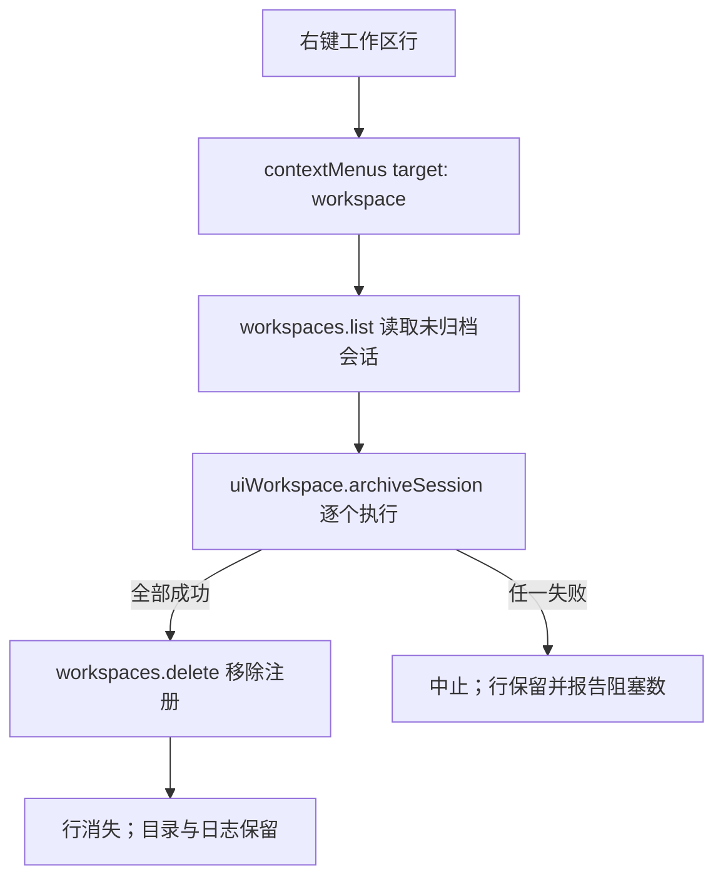

<div align="center">

<h1>dsh-workspace-archiver</h1>

<p><strong>DSH 侧边栏：归档并隐藏一个工作区行——先归档其全部会话，再移除工作区注册。</strong></p>

<p><a href="README.md">简体中文</a> · <a href="README.en.md">English</a></p>

<p>
  <a href="https://github.com/PandaBoby/dsh-workspace-archiver/actions/workflows/ci.yml"></a>
  <a href="https://www.npmjs.com/package/dsh-workspace-archiver"></a>
  <a href="https://github.com/PandaBoby/dsh-workspace-archiver/releases"></a>
  <a href="LICENSE"></a>
  <a href="package.json"></a>
</p>

<p>
  <a href="#快速开始">快速开始</a> ·
  <a href="#工作原理">工作原理</a> ·
  <a href="#已知限制">已知限制</a> ·
  <a href="#故障排查">故障排查</a> ·
  <a href="#开发与测试">开发与测试</a>
</p>

<p><code>dsh plugin --profile &lt;profile&gt; add dsh-workspace-archiver</code></p>

</div>

---

> [!IMPORTANT]
> 本仓库是唯一官方来源：<https://github.com/PandaBoby/dsh-workspace-archiver>。
> 单个会话的归档是 DSH 官方能力；本插件补的是**工作区级动作**：归档该工作区全部会话后
> 移除工作区注册，让整行从侧边栏消失。
> 这是**一次性归档**：目录、会话日志保留，但工作区成员关系不能被公开 API 自动恢复；
> 重新添加目录会创建新的空工作区。详见[已知限制](#已知限制)。

<p align="center">
  
</p>
<p align="center"><sub>示意图：工作区行右键菜单中的“归档并隐藏此工作区”（高亮行）。这不是实机截图。</sub></p>

`dsh-workspace-archiver` 给 DSH 侧边栏补一个工作区行操作：在**工作区行**的右键菜单（或悬停 `…`）里，先归档该工作区所有未归档会话，再移除工作区注册。两步都成功时，整行从侧边栏消失，默认视图里也不会留下这些会话。

DSH 官方已经提供单会话归档，也提供“删除工作区”（只移除注册）。本插件的区别是**把两件事合成一次点击**：不会在移除注册后把未归档会话丢到“未分组”里。

> 当前状态：接口与打包按 DSH `0.2.2-rc.5` 核对，自动化测试与语法门禁通过；**尚未在真实 profile 中安装验证**，菜单、通知和行消失的实际渲染见 [docs/verification.md](docs/verification.md)。

<details>
<summary><strong>目录</strong></summary>

- [功能](#功能)
- [要求](#要求)
- [快速开始](#快速开始)
- [工作原理](#工作原理)
- [与官方 API 的关系](#与官方-api-的关系)
- [已知限制](#已知限制)
- [故障排查](#故障排查)
- [开发与测试](#开发与测试)
- [文档](#文档)
- [安全](#安全)
- [参与贡献](#参与贡献)
- [免责声明](#免责声明)
- [许可证](#许可证)

</details>

## 功能

- **工作区级入口：** 只出现在工作区行的右键菜单/`…` 菜单，顺序在官方 **重命名**（100）与 **删除**（300）之间（200）。
- **先归档、再移除：** 读取该工作区的 `sessionIds`，跳过已归档会话，其余逐个归档；全部成功后调用 `ctx.workspaces.delete` 移除注册，行才消失。
- **失败即中止：** 只要有会话归档失败（仍在运行、权限不足等），就**不移除**工作区；通知报告阻塞数量，控制台给出逐条原因。不会出现“行没了、会话散落在未分组”的半完成状态。
- **目录与日志保留：** 移除的只是工作区注册；目录、会话日志和归档集合都保留，符合官方 `delete` 的语义。
- **运行中不静默停止：** 不传 `stopActivity`；停止运行中的工作是 DSH 单会话归档里的显式确认步骤。
- **防重复点击：** 同一工作区上一轮未结束时忽略重复点击。
- **中英双语：** 菜单与通知文案通过 `ctx.locale` 注册。
- **零构建：** `index.js` / `client.js` 即源码即产物，无依赖、无转译、无 lockfile。

## 要求

| 组件 | 要求 |
|---|---|
| DSH | `>= 0.2.2-rc.1`；接口按 `0.2.2-rc.5` 核对 |
| Node.js | `>= 20`，仅测试套件需要；插件本身运行在 DSH Web/Desktop 页面 |
| 额外服务 | 无；使用 profile 自带的 Workspace Controller、Context Menu 与 Locale |
| 验证状态 | 自动化测试通过；未在真实 profile 安装验证，见 [docs/verification.md](docs/verification.md) |

## 快速开始

### 安装

桌面端：**设置 → 插件 → 添加插件 → 安装本地插件目录**，选择本仓库，然后启用 **Workspace archiver**。

从本地 checkout 安装：

```sh
dsh plugin --profile <profile> add /absolute/path/to/dsh-workspace-archiver
```

npm：

```sh
dsh plugin --profile <profile> add dsh-workspace-archiver
```

安装或启用后刷新一次页面；客户端包由包内的 `./client` 导出提供。

### 使用

1. 在侧边栏找到目标**工作区行**（文件夹那一行，不是下面的会话行）。
2. 右键，或悬停后点 `…`。
3. 选择 **归档并隐藏此工作区（N 个会话）**；如果该工作区没有未归档会话，菜单项显示为 **隐藏此工作区**。
4. 成功后该行消失，通知说明归档数量；目录与会话日志保留。

> 会话行自己的 `…` 菜单是另一套官方菜单（重命名/分支/归档单个会话等），不是本插件的入口。
>
> 如果只是想移除工作区注册、不归档会话，官方 **删除工作区** 动作已经提供该能力。

### 从源码 checkout 加载

在 DSH 源码仓库里运行：

```sh
pnpm dsh web --patch /absolute/path/to/dsh-workspace-archiver/dev.patch.yml
```

先把 `dev.patch.yml` 里的 `/absolute/path/...` 换成本仓库的真实路径。该文件用绝对路径挂载 `index.js`；client-modules 从该路径向上找到 `package.json`，读取 `dsh.client` 并加载 `client.js`。这条路径要求有 DSH 源码 checkout；纯运行时安装（Desktop）请走上面的安装方式。无需构建，改完文件刷新页面即可。

## 工作原理



1. DSH 的工作区行自己派发 `{ kind: 'workspace' }` 右键目标；插件向 `ctx.contextMenus` 注册这个 target 的贡献，不接管 DOM。
2. 菜单打开时，插件从 `ctx.workspaces.list` 取该工作区的 `sessionIds` 和全局归档集合，算出还需要归档的会话。
3. 点击后逐个 `await ctx.uiWorkspace.archiveSession(id)`。这是官方 UI 服务：委托给 Workspace Controller，经 `workspace/archiveSession` Remote 到 Host，最终调用 `workspaceRegistry.archiveSession`，并在被归档会话正是主面板打开的会话时清空主视图。
4. 全部成功后调用 `ctx.workspaces.delete(workspaceId)`。这是官方“删除工作区”的 Client 入口：只移除注册，目录与会话日志保留。行随 Client 模型更新消失。
5. 任一归档失败则不移除注册；通知报告阻塞数量，控制台记录每个会话的失败原因。

## 与官方 API 的关系

| 官方能力 | 用途 |
|---|---|
| `ctx.contextMenus.register({ target: 'workspace' })` | 工作区行右键/`…` 菜单贡献；官方行组件已经派发该 target |
| `ctx.uiWorkspace.archiveSession` | 与官方单会话归档按钮相同的 UI 服务；含主视图清理语义 |
| `ctx.workspaces.list` | 工作区行、成员与全局归档集合，只读 |
| `ctx.workspaces.delete` | 官方“删除工作区”的 Client 入口；只移除注册，保留目录与日志 |
| `ctx.locale.register` / `bind` | 中英文案与语言切换 |
| 官方 bundle 契约 | `dsh.bundle.patch`、`dsh.client`、`./client` 导出、`cordis.patch.yml`、`locale/*.json`、详情图、36×36 图标 |

DSH `0.2.2-rc.5` 中**不存在**的官方能力，本插件没有自造替身：

- **没有工作区级 archive/hide API。** 让行消失的公开操作只有 `workspaces.delete`（官方 **删除工作区**）；它移除注册而不是把注册标记为隐藏。
- **没有恢复成员关系的公开 Client API。** Host 的 `Workspace.attachSession` 不通过 Remote 暴露，所以本插件无法在重新创建的工作区里把旧会话挂回去；没有“撤销”。
- **没有 `ctx.ui.registerMenuItem`，也没有 `sidebar.workspaces.menu.item`。** 工作区菜单是 `ctx.contextMenus` 的 `workspace` target；`sidebar.workspaces.session.menu.item` 是会话行的旧式 React 菜单。
- **没有工作区级确认框。** DSH 的确认流程是单会话/单个操作级别的；本插件用 `danger` 菜单项和明确标签提示风险，不弹自定义确认框。
- **外部插件不能导入 `dsh-client-ui-primitives`**（官方明确要求自写控件），所以菜单项没有图标。

## 已知限制

- **这是一次性归档，没有撤销。** 移除的注册不能通过公开 API 重新隐式恢复；重新添加目录会创建新的空工作区，旧会话不会自动回挂。
- **旧会话不会消失。** 归档集合是全局的；重新添加目录后，取消归档的旧会话会出现在“未分组”里，而不是新工作区下。
- **运行中的会话会阻塞整个操作。** 只要有一个候选会话归档失败，工作区就保持原样；请先停止/等待这些会话，或用官方单会话归档的“停止并归档”确认流程。
- **移除失败会留下“会话已归档、行仍在”的状态。** 通常是权限或 Host 故障；重试一次即可（已归档会话会被跳过），或手动取消归档。
- **批量动作看起来像删除。** 它确实是官方 `delete` 加上会话归档；首次使用建议先在临时 profile 或测试工作区验证。
- **菜单项没有图标。** 官方图标组件不可被外部插件导入；加图标需要一次性 React 组件，本插件保持浏览器半边无 React。

## 故障排查

| 现象 | 处理 |
|---|---|
| 看不到菜单项 | 确认插件已启用并刷新页面；必须右键**工作区行**；工作区已不在列表时不会出现 |
| 点击后行没消失 | 通知会说明是归档失败还是移除失败；归档失败通常是会话在运行，控制台有逐条原因 |
| 行消失了，但旧会话出现在未分组 | 重新添加目录后取消归档旧会话会落到未分组；成员关系不会自动恢复，见[已知限制](#已知限制) |
| 重新添加目录后是空工作区 | 预期行为：`create` 从空成员列表开始，不会扫描历史会话 |
| 想恢复刚才的工作区 | 没有撤销；重新添加目录会创建空工作区，旧会话留在归档集合/未分组 |
| 安装后页面无变化 | 确认 Plugins 页的 **Workspace archiver** 已启用；关掉再开启或刷新页面；检查包内 `client.js` 是否被链接到 |

## 开发与测试

零构建、零依赖；Node.js >= 20 只用于测试：

```sh
npm run check     # client.js 语法、index.js 导出、JSON、patch 行
npm test          # 语法门禁 + 打包与行为测试
```

CI 在 Node 20 / 22 / 24 上运行 `npm test`。发布前检查：

```sh
npm pack --dry-run
```

真实 profile 的手工验证清单见 [docs/verification.md](docs/verification.md)。

## 文档

- [README.en.md](README.en.md) — English README
- [CHANGELOG.md](CHANGELOG.md) — 版本变更
- [CONTRIBUTING.md](CONTRIBUTING.md) — 贡献与发布流程
- [SECURITY.md](SECURITY.md) — 安全边界与漏洞报告
- [docs/verification.md](docs/verification.md) — 已验证/未验证项与手工清单
- [docs/DETAIL.md](docs/DETAIL.md) — 插件详情页单图文档

## 安全

插件不联网、不读写文件、不接触凭据；它只读取工作区/会话 id 与归档集合，并通过 `ctx.uiWorkspace.archiveSession` 与 `ctx.workspaces.delete` 发起操作。权限由 Host 按当前 Peer 执行，插件不绕过。移除注册保留目录与会话日志，但**不可通过公开 API 恢复成员关系**；请把向导出的数据/目录备份视为归档的一部分。漏洞报告请走 [SECURITY.md](SECURITY.md) 的私有渠道。

## 参与贡献

欢迎提交 issue 和 PR，但请先读 [CONTRIBUTING.md](CONTRIBUTING.md)。行为变更需要配套测试和 `CHANGELOG.md` 条目；翻译请保持中英文 README 结构一致。

## 免责声明

本项目按“现状”提供，不附带任何明示或暗示担保。归档并隐藏是不可撤销的工作区注册移除；会话本身可单独取消归档，但成员关系不会恢复。在生产 profile 使用前请先在测试 profile 验证。因误操作、权限配置或第三方插件造成的损失由使用者自行承担。

## 许可证

[MIT](LICENSE) © 2026 dsh-workspace-archiver contributors
