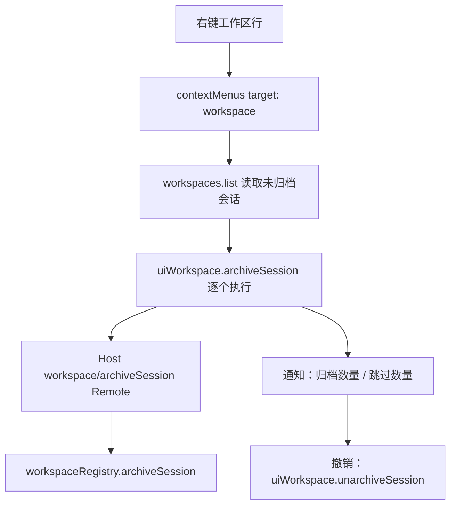

<div align="center">

<h1>dsh-workspace-archiver</h1>

<p><strong>DSH 侧边栏：一次点击归档一个工作区里的全部会话，并在通知里提供撤销。</strong></p>

<p><a href="README.md">简体中文</a> · <a href="README.en.md">English</a></p>

<p>
  <a href="https://github.com/PandaBoby/dsh-workspace-archiver/actions/workflows/ci.yml"></a>
  <a href="https://www.npmjs.com/package/dsh-workspace-archiver"></a>
  <a href="https://github.com/PandaBoby/dsh-workspace-archiver/releases"></a>
  <a href="LICENSE"></a>
  <a href="package.json"></a>
</p>

<p>
  <a href="#快速开始">快速开始</a> ·
  <a href="#工作原理">工作原理</a> ·
  <a href="#已知限制">已知限制</a> ·
  <a href="#故障排查">故障排查</a> ·
  <a href="#开发与测试">开发与测试</a>
</p>

<p><code>dsh plugin --profile &lt;profile&gt; add dsh-workspace-archiver</code></p>

</div>

---

> [!IMPORTANT]
> 本仓库是唯一官方来源：<https://github.com/PandaBoby/dsh-workspace-archiver>。
> 插件不访问网络、不读取凭据、不删除会话日志；归档会把会话移出默认侧边栏视图，撤销走官方
> `unarchiveSession`。
> **它不会隐藏工作区文件夹行**：DSH 没有工作区级隐藏 API，详见[已知限制](#已知限制)。

<p align="center">
  
</p>
<p align="center"><sub>示意图：工作区行右键菜单中的“归档此工作区中的会话”（高亮行）。这不是实机截图。</sub></p>

`dsh-workspace-archiver` 给 [DeepSeek Harness](https://github.com/deepseek-ai) 的侧边栏加一个工作区级操作：在**工作区行**的右键菜单（或悬停 `…`）里归档该工作区中所有未归档会话，并在通知里报告数量、提供**撤销**。

它只调用 DSH 公开扩展点：`ctx.contextMenus` 注册菜单项，`ctx.workspaces.list` 读取状态，`ctx.uiWorkspace` 执行归档/恢复，`ctx.locale` 提供中英文案。没有自建路由，没有自定义权限层，也没有手写 DOM 钩子。

> 当前状态：接口与打包按 DSH `0.2.2-rc.5` 核对，自动化测试与语法门禁通过；**尚未在真实 profile 中安装验证**，菜单、通知和撤销的实际渲染见 [docs/verification.md](docs/verification.md)。

<details>
<summary><strong>目录</strong></summary>

- [功能](#功能)
- [要求](#要求)
- [快速开始](#快速开始)
- [工作原理](#工作原理)
- [与官方 API 的关系](#与官方-api-的关系)
- [已知限制](#已知限制)
- [故障排查](#故障排查)
- [开发与测试](#开发与测试)
- [文档](#文档)
- [安全](#安全)
- [参与贡献](#参与贡献)
- [免责声明](#免责声明)
- [许可证](#许可证)

</details>

## 功能

- **工作区级入口：** 只出现在工作区行的右键菜单/`…` 菜单里，顺序在官方 **重命名**（100）与 **删除**（300）之间（200）。
- **批量但不误伤：** 读取该工作区的 `sessionIds`，排除已归档会话，其余逐个调用归档；已全部归档时菜单项自动隐藏。
- **运行中不静默停止：** 不传 `stopActivity`，由 Host 拒绝正在运行的会话；通知里报告跳过数量，其余会话继续归档。
- **可撤销：** 通知附带 **Undo**，只恢复本次运行归档的那些会话；某一个恢复失败不会中断整批。
- **顺序执行：** 每次归档的回包都带完整归档集合，顺序 `await` 避免客户端投影依赖回包顺序，也避免并发轰击 Host。
- **防重复点击：** 同一工作区上一轮还没结束时，重复点击直接忽略。
- **中英双语：** 菜单与通知文案通过 `ctx.locale` 注册，切换语言时已打开的菜单会重新解析。
- **零构建：** `index.js` / `client.js` 即源码即产物，无依赖、无转译、无 lockfile。

## 要求

| 组件 | 要求 |
|---|---|
| DSH | `>= 0.2.2-rc.1`；接口按 `0.2.2-rc.5` 核对 |
| Node.js | `>= 20`，仅测试套件需要；插件本身运行在 DSH Web/Desktop 页面 |
| 额外服务 | 无；使用 profile 自带的 Workspace Controller、Context Menu 与 Locale |
| 验证状态 | 自动化测试通过；未在真实 profile 安装验证，见 [docs/verification.md](docs/verification.md) |

## 快速开始

### 安装

桌面端：**设置 → 插件 → 添加插件 → 安装本地插件目录**，选择本仓库，然后启用 **Workspace archiver**。

从本地 checkout 安装：

```sh
dsh plugin --profile <profile> add /absolute/path/to/dsh-workspace-archiver
```

npm（发布后）：

```sh
dsh plugin --profile <profile> add dsh-workspace-archiver
```

安装或启用后刷新一次页面；客户端包由包内的 `./client` 导出提供。

### 使用

1. 在侧边栏找到目标**工作区行**（文件夹那一行，不是下面的会话行）。
2. 右键，或悬停后点 `…`。
3. 选择 **归档此工作区中的会话**。
4. 通知会报告归档数量；需要回退时点 **撤销**。

> 会话行自己的 `…` 菜单是另一套官方菜单（重命名/分支/归档单个会话等），不是本插件的入口。

### 从源码 checkout 加载

在 DSH 源码仓库里运行：

```sh
pnpm dsh web --patch /absolute/path/to/dsh-workspace-archiver/dev.patch.yml
```

`dev.patch.yml` 用绝对路径挂载 `index.js`；client-modules 从该路径向上找到 `package.json`，读取 `dsh.client` 并加载 `client.js`。这条路径要求有 DSH 源码 checkout；纯运行时安装（Desktop）请走上面的安装方式。无需构建，改完文件刷新页面即可。

## 工作原理



1. DSH 的工作区行自己派发 `{ kind: 'workspace' }` 右键目标；插件向 `ctx.contextMenus` 注册这个 target 的贡献，不接管 DOM。
2. 菜单打开时，插件从 `ctx.workspaces.list` 取该工作区的 `sessionIds` 和全局归档集合，算出候选会话。
3. 点击后逐个 `await ctx.uiWorkspace.archiveSession(id)`。这是官方 UI 服务：它委托给 Workspace Controller，经 `workspace/archiveSession` Remote 到 Host，最终调用 `workspaceRegistry.archiveSession`，并在被归档会话正是主面板打开的会话时清空主视图。
4. 成功的 id 进入撤销集合；失败的 id 记日志并在通知里计数。通知通过 `ctx.contextMenus.notify` 展示，撤销动作逐个 `await ctx.uiWorkspace.unarchiveSession(id)`。

## 与官方 API 的关系

| 官方能力 | 用途 |
|---|---|
| `ctx.contextMenus.register({ target: 'workspace' })` | 工作区行右键/`…` 菜单贡献；官方行组件已经派发该 target |
| `ctx.contextMenus.notify(text, ok, action)` | 结果通知与撤销动作 |
| `ctx.uiWorkspace.archiveSession` / `unarchiveSession` | 与官方归档按钮相同的 UI 服务；含主视图清理语义 |
| `ctx.workspaces.list` | 工作区行、成员与全局归档集合，只读 |
| `ctx.locale.register` / `bind` | 中英文案与语言切换 |
| 官方 bundle 契约 | `dsh.bundle.patch`、`dsh.client`、`./client` 导出、`cordis.patch.yml`、`locale/*.json`、详情图、36×36 图标 |

DSH `0.2.2-rc.5` 中**不存在**的官方能力，本插件没有自造替身：

- **没有工作区级归档/隐藏 API。** 注册表只有会话级，所以只能遍历 `sessionIds`；会话全部归档后工作区分组仍会渲染。
- **没有 `ctx.ui.registerMenuItem`，也没有 `sidebar.workspaces.menu.item`。** 工作区菜单是 `ctx.contextMenus` 的 `workspace` target；`sidebar.workspaces.session.menu.item` 是会话行的旧式 React 菜单。
- **外部插件不能导入 `dsh-client-ui-primitives`**（官方明确要求自写控件），所以菜单项没有图标，而不是画一个近似图标。
- **没有工作区级确认框。** DSH 的确认流程是单会话的；因此批量操作跳过运行中的会话并报告，不静默停止。
- `ctx.remoteAccess.source(...)` 的文档写明只应由资源所属包调用；本插件没有伸进这层权限管道，权限由 Host 在每次归档时执行。

## 已知限制

- **工作区行不会消失。** 归档全部会话后分组变空，但 DSH 仍为每个已注册工作区渲染一行（`dsh-client-ui-workspace/src/client/tree.ts` 的 `groupByWorkspace`，0.2.2-rc.5）。要真正隐藏行，需要改上游过滤逻辑、删除工作区注册（官方 **删除** 动作，会话会落回未分组），或整体替换 `sidebar.workspaces` 插槽；本插件不采用最后一种。
- **运行中的会话不会被归档。** 插件不传 `stopActivity: true`；请先停止/等待这些会话，或用官方单会话归档里的“停止并归档”确认流程。
- **撤销只覆盖最近一次运行。** 通知消失后，可在“显示已归档”视图或会话行菜单里逐个恢复。
- **批量归档看起来像破坏性操作。** 它可撤销，但通知是临时的；首次使用建议先在临时 profile 或测试工作区验证。
- **菜单项没有图标。** 官方图标组件不可被外部插件导入；加图标需要一次性 React 组件，本插件保持浏览器半边无 React。

## 故障排查

| 现象 | 处理 |
|---|---|
| 看不到菜单项 | 确认插件已启用并刷新页面；必须右键**工作区行**；该工作区没有未归档会话时菜单项会隐藏 |
| 点击后没有归档 | 通常所有候选会话都在运行中，或当前 Peer 没有归档权限；通知会给出跳过数量，控制台有逐条原因 |
| 通知里的撤销不见了 | 通知已消失，或这次没有成功归档任何会话；到“显示已归档”视图逐个恢复 |
| 归档后工作区还在 | 预期行为，见[已知限制](#已知限制) |
| 插件安装后页面无变化 | 确认 Plugins 页的 **Workspace archiver** 已启用；关掉再开启或刷新页面；检查包内 `client.js` 是否被链接到 |

## 开发与测试

零构建、零依赖；Node.js >= 20 只用于测试：

```sh
npm run check     # client.js 语法、index.js 导出、JSON、patch 行
npm test          # 语法门禁 + 打包与行为测试
```

CI 在 Node 20 / 22 / 24 上运行 `npm test`。发布前检查：

```sh
npm pack --dry-run
```

真实 profile 的手工验证清单见 [docs/verification.md](docs/verification.md)。

## 文档

- [README.en.md](README.en.md) — English README
- [CHANGELOG.md](CHANGELOG.md) — 版本变更
- [CONTRIBUTING.md](CONTRIBUTING.md) — 贡献与发布流程
- [SECURITY.md](SECURITY.md) — 安全边界与漏洞报告
- [docs/verification.md](docs/verification.md) — 已验证/未验证项与手工清单
- [docs/DETAIL.md](docs/DETAIL.md) — 插件详情页单图文档

## 安全

插件不联网、不读写文件、不接触凭据；它只读取工作区/会话 id 与归档集合，并通过 `ctx.uiWorkspace` 发起归档/恢复。权限由 Host 按当前 Peer 执行，插件不绕过。归档保留会话日志与工作区账目，但会让会话从默认视图消失；请把通知里的撤销当作可回退窗口而不是永久备份。漏洞报告请走 [SECURITY.md](SECURITY.md) 的私有渠道。

## 参与贡献

欢迎提交 issue 和 PR，但请先读 [CONTRIBUTING.md](CONTRIBUTING.md)。行为变更需要配套测试和 `CHANGELOG.md` 条目；翻译请保持中英文 README 结构一致。

## 免责声明

本项目按“现状”提供，不附带任何明示或暗示担保。批量归档是可逆操作，但通知是临时的；在生产 profile 使用前请先在测试 profile 验证。因误归档、权限配置或第三方插件造成的损失由使用者自行承担。

## 许可证

[MIT](LICENSE) © 2026 dsh-workspace-archiver contributors
